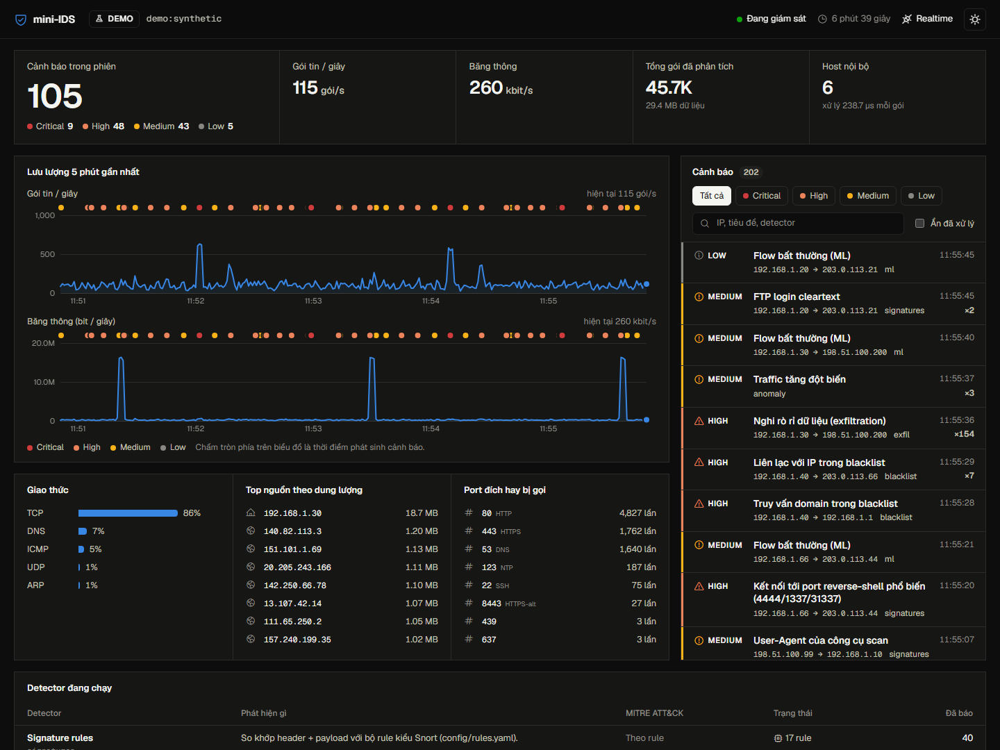
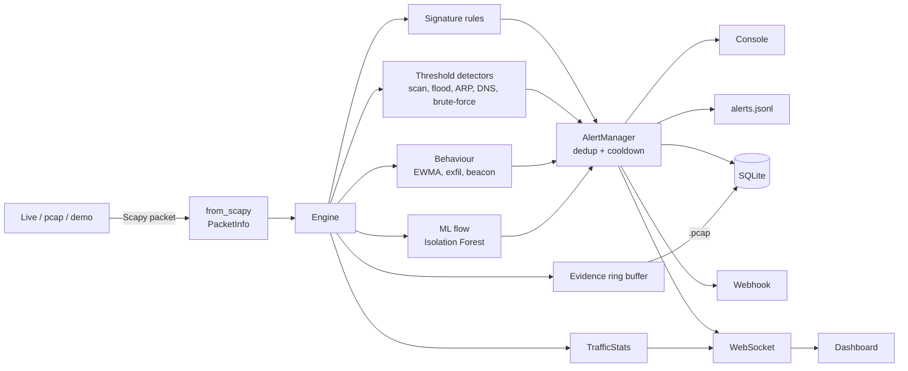

# mini-IDS

Network traffic monitor và hệ thống phát hiện xâm nhập (IDS) viết bằng Python + Scapy. Bắt gói tin (hoặc đọc file pcap của Wireshark), phát hiện traffic bất thường bằng **signature + thống kê + machine learning**, ghi log, cảnh báo và hiển thị trên dashboard realtime.

Dự án học tập: mỗi detector được chú thích bằng tiếng Việt, giải thích tấn công là gì, dấu hiệu trên mạng, cách phát hiện và false positive hay gặp. Lộ trình học chi tiết ở [docs/LEARNING.md](docs/LEARNING.md).



## Tính năng

| Nhóm | Chi tiết |
|---|---|
| Nguồn gói tin | Live capture (Npcap/libpcap), replay file `.pcap/.pcapng`, traffic giả lập có 16 kịch bản tấn công |
| 12 detector | Port scan (vertical/horizontal/stealth), SYN flood, ICMP flood & ping sweep, ARP spoofing, DNS tunneling & DGA, brute-force, threat intel blacklist, signature rule kiểu Snort, traffic spike (EWMA z-score), data exfiltration, C2 beaconing, ML flow anomaly (Isolation Forest tự viết bằng numpy) |
| Cảnh báo | Gộp trùng + cooldown (chống alert fatigue), console màu, JSONL kiểu Suricata EVE, SQLite, webhook Discord/Slack/Telegram |
| Bằng chứng | Mỗi alert kèm file `.pcap` các gói liên quan, mở thẳng bằng Wireshark |
| Dashboard | FastAPI + WebSocket: lưu lượng realtime, giao thức, top talkers, feed cảnh báo, chi tiết + MITRE ATT&CK, tải pcap, đánh dấu đã xử lý, sáng/tối |
| Mapping | Mọi alert gắn technique MITRE ATT&CK (T1046, T1498, T1557.002, T1071.004, T1110, T1048...) |

## Chạy nhanh (Windows)

```powershell
git clone https://github.com/NovWyatt/mini-ids.git
cd mini-ids
python -m venv .venv
.venv\Scripts\python -m pip install -e ".[dev]"

# Demo: traffic giả lập + tấn công mẫu, không cần Npcap hay quyền admin
.venv\Scripts\mini-ids demo --open
```

Mở http://127.0.0.1:8800. Khoảng 35 giây đầu là traffic sạch (IDS học baseline), sau đó cứ 10 giây một kịch bản tấn công xuất hiện.

### Bắt gói thật

Cần **Npcap** (Windows) để Scapy đọc card mạng:

1. Cài [Wireshark](https://www.wireshark.org/download.html) và tick *Install Npcap* (hoặc cài riêng [Npcap](https://npcap.com)).
2. Mở terminal mới:

```powershell
.venv\Scripts\mini-ids interfaces            # xem tên card mạng
.venv\Scripts\mini-ids live -i "Wi-Fi"        # bắt gói + dashboard
.venv\Scripts\mini-ids live -i "Wi-Fi" -f "not port 3389" --no-web
```

> Chỉ giám sát mạng của bạn hoặc mạng được phép bằng văn bản.

### Phân tích file pcap

```powershell
# Sinh file pcap chứa traffic thường + 16 kịch bản tấn công, mở được bằng Wireshark
.venv\Scripts\mini-ids gen-pcap captures/demo-attacks.pcap

# Cho IDS phân tích (profile demo hạ vài ngưỡng cho traffic ngắn)
.venv\Scripts\mini-ids replay captures/demo-attacks.pcap --config config/demo.yaml

# Replay file bắt từ Wireshark với tốc độ thực
.venv\Scripts\mini-ids replay capture.pcapng --speed 1
```

### Lệnh khác

| Lệnh | Tác dụng |
|---|---|
| `mini-ids alerts [-s high] [--demo]` | Xem alert đã lưu trong SQLite |
| `mini-ids info` | Liệt kê detector, signature rule, MITRE ATT&CK |
| `mini-ids train normal.pcap` | Huấn luyện model ML từ traffic bình thường của bạn |
| `mini-ids intel update` | Tải blacklist IP từ abuse.ch Feodo Tracker và Emerging Threats |

## Kiến trúc



| File | Vai trò |
|---|---|
| [mini_ids/packet.py](mini_ids/packet.py) | Chuẩn hoá gói Scapy thành `PacketInfo` (parse 1 lần, detector không phụ thuộc Scapy) |
| [mini_ids/engine.py](mini_ids/engine.py) | Đưa từng gói qua thống kê, evidence và 12 detector; tick mỗi giây |
| [mini_ids/detectors/](mini_ids/detectors) | Mỗi file một kỹ thuật phát hiện, có giải thích |
| [mini_ids/manager.py](mini_ids/manager.py) | Gộp alert trùng, ghi evidence, phát tới các sink |
| [mini_ids/iforest.py](mini_ids/iforest.py) | Isolation Forest viết tay, chấm điểm vector hoá |
| [mini_ids/capture/synthetic.py](mini_ids/capture/synthetic.py) | Traffic giả lập + kịch bản tấn công (chỉ dựng trong bộ nhớ, không gửi ra mạng) |
| [mini_ids/web/](mini_ids/web) | FastAPI server + dashboard HTML/JS/CSS thuần |
| [config/rules.yaml](config/rules.yaml) | Signature rule, so sánh trực tiếp với cú pháp Snort |

## Cấu hình

Sửa ngưỡng trong [config/default.yaml](config/default.yaml). Muốn đổi riêng trên máy mình, tạo `config/local.yaml` chỉ chứa phần cần đổi (file này không bị commit), ví dụ bật cảnh báo Discord:

```yaml
alerting:
  webhook:
    enabled: true
    kind: discord
    url: "https://discord.com/api/webhooks/..."
    min_severity: high
```

## Đầu ra

| Đường dẫn | Nội dung |
|---|---|
| `logs/alerts.jsonl` | 1 dòng JSON mỗi alert, dễ nạp vào ELK / Splunk / Wazuh |
| `logs/ids.db` | SQLite lịch sử alert (dashboard và `mini-ids alerts` đọc từ đây) |
| `logs/mini_ids.log` | Log ứng dụng |
| `evidence/<alert-id>.pcap` | Gói tin liên quan tới alert |
| `models/iforest.json` | Model ML đã học (JSON, không dùng pickle để tránh thực thi code khi load) |

Chế độ demo ghi vào `logs/demo.db`, `logs/demo-alerts.jsonl`, `evidence/demo/` để không lẫn với dữ liệu thật.

## Kiểm thử

```powershell
.venv\Scripts\python -m pytest
```

66 test: unit test từng detector (cả trường hợp dương tính và traffic bình thường không được báo), mỗi kịch bản tấn công phải bị đúng detector bắt, 3 phút traffic bình thường phải không có cảnh báo nào, API dashboard, chống path traversal khi tải pcap.

## Giới hạn đã biết

- Scapy xử lý khoảng 3.000 đến 7.000 gói/giây trên laptop, đủ cho mạng gia đình / lab, không dành cho đường truyền doanh nghiệp (khi đó dùng Suricata / Zeek).
- Không giải mã TLS: tấn công web qua HTTPS chỉ thấy được bằng detector hành vi (beacon, exfil, ML), không bằng signature.
- ML ở mức flow không phân biệt được brute-force, DGA hay SQLi với flow thường; phần đó do signature và detector chuyên biệt đảm nhiệm.

## License

MIT. Font Geist (OFL 1.1) và icon Phosphor (MIT) được đóng gói trong `mini_ids/web/static/vendor`.
